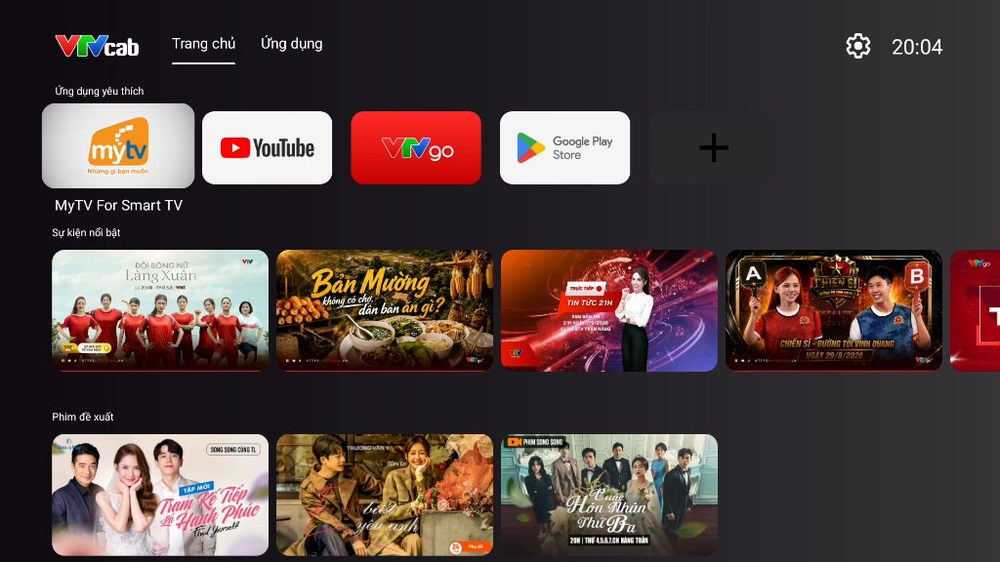

# 43nct 📺

<p align="center">
  
</p>

<p align="center">
  <b>Trình khởi chạy hệ thống 43nct (bản port từ launcher SDMC Smartbox 3 Plus VTVcab)</b>
</p>

<p align="center">
  
  
  
  
  
  
</p>

---

## ✨ Tính năng chính (Key Features)

- 🎮 **Chuẩn giao diện Leanback**: Giao diện trực quan, thẻ bo góc hiện đại, phản hồi tức thì với mọi thao tác điều hướng từ remote TV.
- ⭐ **Quản lý ứng dụng yêu thích (Favorite Apps)**: 
  - Ghim và sắp xếp thứ tự các ứng dụng hay dùng nhất lên hàng đầu.
  - Hỗ trợ thêm/bớt và di chuyển vị trí nhanh chóng trực tiếp trên TV.
- 📡 **Tích hợp kênh đề xuất (Android TV Listings / TIF)**: 
  - Đọc và đồng bộ dữ liệu nội dung, chương trình đề xuất từ các ứng dụng truyền hình hỗ trợ chuẩn Android TV TIF.
- 🛠️ **Tùy biến hiển thị & sắp xếp kênh**: 
  - Menu cấu hình trực quan cho phép người dùng tùy chọn bật/tắt hoặc hoán đổi vị trí từng hàng kênh hiển thị ngoài trang chủ.
- 🌐 **Đa ngôn ngữ thông minh**: 
  - Tự động đồng bộ và hiển thị chuẩn xác theo ngôn ngữ hệ thống TV (Tiếng Việt, Tiếng Anh,...).
- ⚡ **Gói tối ưu hóa cho thiết bị RAM thấp (Low-RAM Optimization)**:
  - **Giảm 50% RAM xử lý ảnh**: Sử dụng định dạng `RGB_565` trong Glide, tối ưu hóa bộ nhớ khi tải hàng trăm hình ảnh poster phim.
  - **Tự động dọn RAM (`onTrimMemory` / `onLowMemory`)**: Tự động giải phóng cache bộ đệm khi phát hiện hệ thống thiếu RAM, chống văng ứng dụng (OOM).
  - **Shared RecycledViewPool**: Toàn bộ hàng kênh dùng chung một kho View tái sử dụng, loại bỏ hiện tượng giật khung hình khi cuộn dọc trang chủ.
  - **Tự động thích ứng phần cứng**: Tự nhận diện thiết bị yếu (`isLowRamDevice`) để tắt các animation đổ bóng/đổi màu nền liên tục, tập trung toàn bộ CPU/GPU cho độ mượt thao tác.

---

## 🛠️ Biên dịch từ mã nguồn (Build from Source)

### Yêu cầu môi trường:
* **JDK**: OpenJDK 17 trở lên
* **Android SDK**: API Level 34 (Android 14)
* **Gradle Build Tools**: 8.5+

### Các lệnh biên dịch:
```bash
# Clone dự án về máy
git clone https://github.com/mSystem-VTVcab27/43nct-launcher.git
cd 43nct-launcher

# Biên dịch bản Debug APK
./gradlew assembleDebug

# Hoặc biên dịch bản Release APK
./gradlew assembleRelease
```
*File APK sau khi build thành công sẽ nằm tại: `app/build/outputs/apk/`.*

---

## 📂 Cấu trúc thư mục (Project Structure)

```text
├── app/
│   ├── src/main/
│   │   ├── java/com/vctv/launcher/
│   │   │   ├── app/           # Quản lý danh sách ứng dụng, dialog yêu thích
│   │   │   ├── config/        # Phân tích cấu hình và theme launcher
│   │   │   ├── data/          # CSDL Room/SQLite, kênh truyền hình (TIF)
│   │   │   ├── home/          # Giao diện hàng kênh, thẻ chương trình
│   │   │   ├── tab/           # Quản lý chuyển tab Trang chủ / Ứng dụng
│   │   │   └── util/          # GlideModule, helper tối ưu hóa RAM & màu sắc
│   │   ├── res/               # Tài nguyên layout, drawable, icon, strings
│   │   └── AndroidManifest.xml
│   └── build.gradle.kts
├── gradle/
├── .gitignore
├── README.md
└── settings.gradle.kts
```

---

## 🔒 Bản quyền & Giấy phép (License & Disclaimer)

- **Mục đích phi thương mại (Non-Commercial Use Only)**:
  - Dự án này được nghiên cứu, phát triển và tùy biến hoàn toàn vì mục đích **nghiên cứu cá nhân và phi thương mại**.
- **Tuyên bố miễn trừ trách nhiệm (Disclaimer)**:
  - Tất cả các nhãn hiệu, logo và tài nguyên thương hiệu (nếu có) thuộc quyền sở hữu của các chủ sở hữu tương ứng. Dự án không liên kết, không đại diện và không được tài trợ bởi bất kỳ đơn vị cung cấp dịch vụ truyền hình hay tổ chức thương mại nào.

